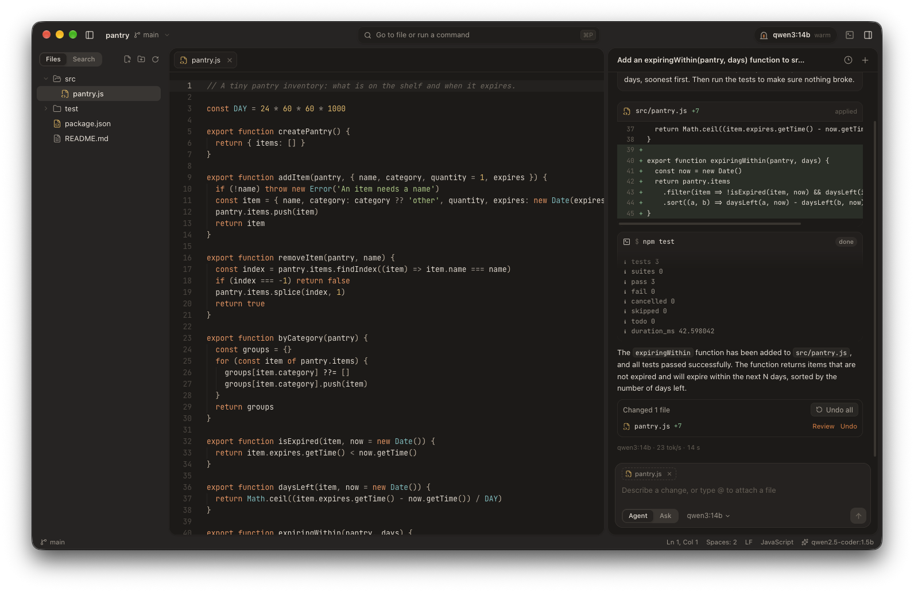
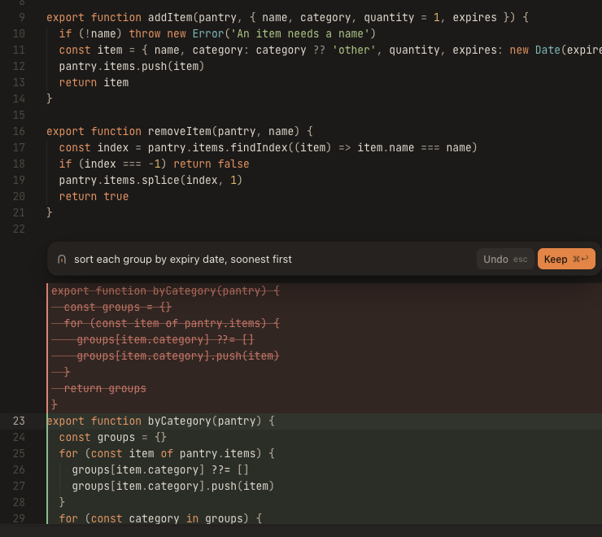
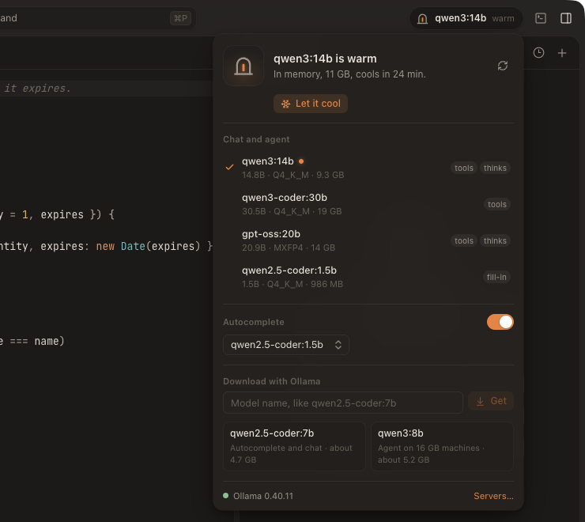

<p align="center">
  
</p>

<h1 align="center">Hearth</h1>

<p align="center">
  A calm code editor for AI models that live on your machine.<br />
  Agent, inline edits and autocomplete, powered by Ollama, LM Studio or llama.cpp. Nothing leaves your computer.
</p>

<p align="center">
  <a href="https://github.com/Myrhex-x/Hearth/releases/latest"><b>Download for macOS and Windows</b></a>
  ·
  <a href="#build-from-source">Build from source</a>
  ·
  <a href="#getting-a-model">Getting a model</a>
</p>

<p align="center">
  
</p>

## Why

Tools like Cursor showed how good it feels to code next to a model that can read your project, change it and run your tests. Hearth brings that to local models: your code and your prompts stay on your computer, it works offline, and there is no account, subscription or telemetry.

Local models are smaller than cloud ones, so Hearth is built to help them succeed: short focused tools, edits that forgive whitespace mistakes, recovery when a model prints a tool call as text instead of calling it, a context window that trims old output first, and approvals before anything risky.

## What it does

- **Agent mode.** Describe a change. The model reads and searches your files, makes focused edits that show up as diffs, and runs commands like your tests after you approve them. Every change can be reviewed and undone, file by file or all at once.
- **Ask mode.** The same project awareness with read-only tools, for questions and explanations.
- **Edit with ⌘K (Ctrl+K on Windows).** Select code, describe what you want, watch the rewrite stream in place next to the original, then keep it or undo it.
- **Tab autocomplete.** Ghost-text suggestions from a small fill-in-the-middle model such as `qwen2.5-coder:1.5b`.
- **The ember.** The mark in the title bar shows the model's state: cold, warming up, warm in memory, or writing (with tokens per second). Open it to see memory use, warm a model up before you need it, let it cool to free memory, or download new models.
- **Any local server.** Ollama, LM Studio, llama.cpp, vLLM, Jan, or anything that speaks the OpenAI chat API, including a server on another machine of yours.
- **A real editor.** Monaco (the editor inside VS Code) with warm Coal and Paper themes, tabs, quick open, project search, a command palette and a built-in terminal.
- **Project rules.** Hearth reads `AGENTS.md`, `.hearth/rules.md` and `.cursorrules` and passes them to the model.
- **At home on both systems.** Translucent sidebar, traffic lights and a native menu bar on macOS. Native window controls, PowerShell and Windows shortcuts on Windows.

<p align="center">
  
  
</p>

## Download

Get the latest build from the [releases page](https://github.com/Myrhex-x/Hearth/releases/latest):

| System | File |
| --- | --- |
| macOS, Apple silicon | `Hearth-x.y.z-mac-arm64.dmg` |
| macOS, Intel | `Hearth-x.y.z-mac-x64.dmg` |
| Windows, x64 | `Hearth-x.y.z-windows-x64-setup.exe` |
| Windows, Arm | `Hearth-x.y.z-windows-arm64-setup.exe` |

The builds are not code signed yet, so each system asks once before opening them:

- **macOS:** open the app, then go to System Settings, Privacy and Security, and click **Open Anyway**. Or run `xattr -dr com.apple.quarantine /Applications/Hearth.app`.
- **Windows:** if SmartScreen says "Windows protected your PC", click **More info**, then **Run anyway**.

## Getting a model

1. Install [Ollama](https://ollama.com/download) (or LM Studio, or llama.cpp's `llama-server`).
2. Open Hearth and click the ember in the title bar. It lists what is installed and offers one-click downloads.
3. Pick one model for the agent and, optionally, a small one for autocomplete.

The agent needs a model that supports tool calling. Good starting points:

| Memory in your computer | Agent and chat | Autocomplete |
| --- | --- | --- |
| 8 GB | `qwen3:4b` | `qwen2.5-coder:1.5b` |
| 16 GB | `qwen3:8b` | `qwen2.5-coder:1.5b` |
| 32 GB | `qwen3:14b` or `gpt-oss:20b` | `qwen2.5-coder:7b` |
| 64 GB or more | `qwen3-coder:30b` | `qwen2.5-coder:7b` |

LM Studio and llama.cpp are found automatically on their default ports (`127.0.0.1:1234` and `127.0.0.1:8080`). Other servers can be added in Settings, Models.

## Shortcuts

| Action | macOS | Windows |
| --- | --- | --- |
| Go to a file | ⌘P | Ctrl+P |
| Show every command | ⇧⌘P | Ctrl+Shift+P |
| Edit the selection with the model | ⌘K | Ctrl+K |
| Ask about the selection in the chat | ⌘L | Ctrl+L |
| New chat | ⇧⌘L | Ctrl+Shift+L |
| Find in the project | ⇧⌘F | Ctrl+Shift+F |
| Toggle the terminal | ⌃\` | Ctrl+\` |
| Toggle the sidebar, the chat | ⌘B, ⌥⌘B | Ctrl+B, Ctrl+Alt+B |
| Settings | ⌘, | Ctrl+, |

In the chat, type `@` to attach a file, and use the Agent and Ask switch under the message box.

## Privacy and safety

- Hearth talks only to the model servers listed in Settings. By default those are on `127.0.0.1`. There is no telemetry and no account.
- The agent can only read and write inside the folder you opened. Deleted files go to the Trash or the Recycle Bin.
- Commands always wait for your approval unless you turn that off in Settings, Agent. Edits are applied right away by default and can be undone from the chat; you can make them wait for approval too.

## Build from source

You need [Node.js](https://nodejs.org) 22 or newer.

```bash
git clone https://github.com/Myrhex-x/Hearth.git
cd Hearth
npm install
npm run dev
```

Other scripts:

| Script | What it does |
| --- | --- |
| `npm run build` | Builds the app into `out/` |
| `npm start` | Runs the built app |
| `npm test` | Unit tests (edit matching, paths, streaming, tool parsing) |
| `npm run e2e` | Drives the real app against a scripted mock Ollama server |
| `npm run dist:mac` | Packages a `.dmg` and `.zip` into `release/` |
| `npm run dist:win` | Packages a Windows installer into `release/` |

Every push runs the unit and end-to-end tests on Windows, macOS and Linux in GitHub Actions. Tagging a version (`git tag v0.2.0 && git push --tags`) builds and publishes the installers.

## How it is put together

| Folder | Role |
| --- | --- |
| `src/main` | Electron main process: windows, the `hearth://` protocol, file access scoped to the open folder, the terminal (node-pty), commands, and all model traffic (`llm/`) |
| `src/preload` | The small, typed bridge the interface uses (`window.hearth`) |
| `src/renderer` | The interface: React, Monaco, xterm.js, the agent loop (`agent/`, `state/chat.ts`), inline edit and autocomplete (`editor/`) |
| `src/shared` | Code used on both sides: types, the forgiving edit matcher, tool call recovery, the reasoning splitter |

## Contributing

Issues and pull requests are welcome. Run `npm run typecheck && npm test` before opening a pull request, and `npm run e2e` if you touched the interface.

## License

[MIT](LICENSE)
