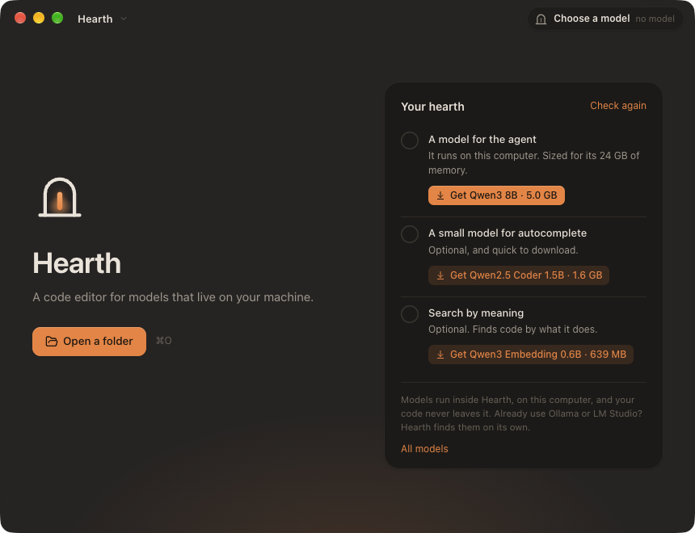
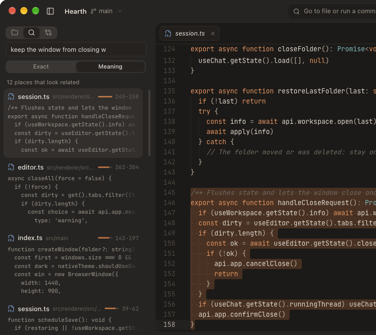
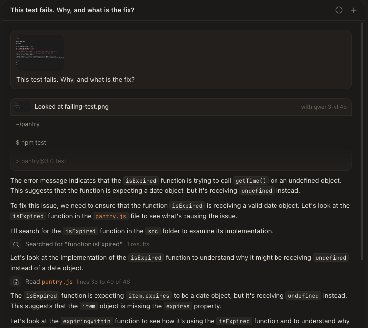
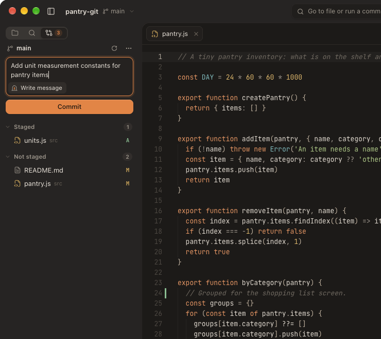

<p align="center">
  
</p>

<h1 align="center">Hearth</h1>

<p align="center">
  A calm code editor for AI models that live on your machine.<br />
  Agent, inline edits, autocomplete and search by meaning, with models that run inside Hearth. Nothing else to install, and nothing leaves your computer.
</p>

<p align="center">
  <a href="https://github.com/Myrhex-x/Hearth/releases/latest"><b>Download for macOS and Windows</b></a>
  ·
  <a href="#build-from-source">Build from source</a>
  ·
  <a href="#getting-a-model">Getting a model</a>
</p>

<p align="center">
  
</p>

## Why

Tools like Cursor showed how good it feels to code next to a model that can read your project, change it and run your tests. Hearth brings that to local models: your code and your prompts stay on your computer, it works offline, and there is no account, subscription or telemetry.

Local models are smaller than cloud ones, so Hearth is built to help them succeed: short focused tools, edits that forgive whitespace mistakes, recovery when a model prints a tool call as text instead of calling it, a context window that trims old output first, and approvals before anything risky.

## What it does

- **Models built in.** Hearth runs models itself, with llama.cpp inside the app. Pick one sized for your computer, download it from Hearth, and start. Ollama, LM Studio and other local servers still work alongside.
- **Agent mode.** Describe a change. The model reads and searches your files, makes focused edits that show up as diffs, and runs commands like your tests after you approve them. Every change can be reviewed and undone, file by file or all at once.
- **Ask mode.** The same project awareness with read-only tools, for questions and explanations.
- **Edit with ⌘K (Ctrl+K on Windows).** Select code, describe what you want, watch the rewrite stream in place next to the original, then keep it or undo it.
- **Tab autocomplete.** Ghost-text suggestions from a small fill-in-the-middle model such as `qwen2.5-coder:1.5b`.
- **Source control.** See what changed since your last commit, in the file tree, in the editor gutter and in a Changes panel with diffs. Stage, discard, commit, pull and push, and let your local model write the commit message from the diff.
- **A chat that keeps up.** Retry an answer or edit your last request, click file names in answers to open them, and watch how full the model's context window is getting.
- **Search by meaning.** Find code by what it does, like "keep the window from closing with unsaved files", even when it uses none of those words. A small embedding model indexes the project on your computer and keeps up as files change. The agent can search the same way, and a model without tools gets the code that clearly relates to your question attached for it.
- **Screenshots in the chat.** Paste, drop or attach an image: an error, a broken layout, a mockup. A model that can see, like `qwen3-vl`, looks at it directly. For one that cannot, a small vision model first writes down what the image shows, every word of text included, so any model can work from a screenshot.
- **The ember.** The mark in the title bar shows the model's state: cold, warming up, warm in memory, or writing (with tokens per second). Open it to see memory use, warm a model up before you need it, let it cool to free memory, or download new models.
- **Any local server.** Ollama, LM Studio, llama.cpp, vLLM, Jan, or anything that speaks the OpenAI chat API, including a server on another machine of yours.
- **A real editor.** Monaco (the editor inside VS Code) with warm Coal and Paper themes, tabs, quick open, project search, a command palette and a built-in terminal.
- **Project rules.** Hearth reads `AGENTS.md`, `.hearth/rules.md` and `.cursorrules` and passes them to the model.
- **At home on both systems.** Translucent sidebar, traffic lights and a native menu bar on macOS. Native window controls, PowerShell and Windows shortcuts on Windows.

<p align="center">
  
</p>

<p align="center">
  
  
</p>

<p align="center">
  
  
</p>

<p align="center">
  
</p>

## Download

Get the latest build from the [releases page](https://github.com/Myrhex-x/Hearth/releases/latest):

| System | File |
| --- | --- |
| macOS, Apple silicon | `Hearth-x.y.z-mac-arm64.dmg` |
| macOS, Intel | `Hearth-x.y.z-mac-x64.dmg` |
| Windows, x64 | `Hearth-x.y.z-windows-x64-setup.exe` |
| Windows, Arm | `Hearth-x.y.z-windows-arm64-setup.exe` |

The builds are not code signed yet, so each system asks once before opening them:

- **macOS:** open the app, then go to System Settings, Privacy and Security, and click **Open Anyway**. Or run `xattr -dr com.apple.quarantine /Applications/Hearth.app`.
- **Windows:** if SmartScreen says "Windows protected your PC", click **More info**, then **Run anyway**.

## Getting a model

Open Hearth. The welcome screen suggests an agent model sized for your computer's memory, with its download size on the button. Click it, and that is all. A small model for autocomplete and one for search by meaning are one more click each, there or under the ember in the title bar.

| Memory in your computer | Agent and chat |
| --- | --- |
| 8 GB | Qwen3 4B, 2.5 GB |
| 16 GB | Qwen3 8B, 5.0 GB |
| 32 GB | Qwen3 14B, 9.0 GB, or gpt-oss 20B, 12 GB |
| 48 GB or more | Qwen3 Coder 30B, 19 GB |

| For | Model | Download |
| --- | --- | --- |
| Autocomplete | Qwen2.5 Coder 1.5B | 1.6 GB |
| Search by meaning | Qwen3 Embedding 0.6B | 640 MB |
| Reading images for a chat model that cannot | Qwen3 VL 4B | 3.0 GB |

Qwen3 VL 4B also works as the chat model itself: it uses tools and sees images directly.

The models come from Hugging Face, pinned to an exact version and checked against their checksum before Hearth uses them. A download that stops continues where it left off. They are kept in Hearth's data folder, and Settings, Models lists them and frees the space.

Already use [Ollama](https://ollama.com/download) or LM Studio? Hearth finds them on their default ports and lists their models next to its own, and the ember can download Ollama models too. A llama.cpp server of your own, or any other server that speaks the OpenAI API, can be added in Settings, Models.

## Shortcuts

| Action | macOS | Windows |
| --- | --- | --- |
| Go to a file | ⌘P | Ctrl+P |
| Show every command | ⇧⌘P | Ctrl+Shift+P |
| Edit the selection with the model | ⌘K | Ctrl+K |
| Ask about the selection in the chat | ⌘L | Ctrl+L |
| New chat | ⇧⌘L | Ctrl+Shift+L |
| Find in the project | ⇧⌘F | Ctrl+Shift+F |
| Show changes (source control) | ⌃⇧G | Ctrl+Shift+G |
| Toggle the terminal | ⌃\` | Ctrl+\` |
| Toggle the sidebar, the chat | ⌘B, ⌥⌘B | Ctrl+B, Ctrl+Alt+B |
| Settings | ⌘, | Ctrl+, |

In the chat, type `@` to attach a file, paste or drop an image, and use the Agent and Ask switch under the message box. To search by meaning, open Find in the project and switch to Meaning.

## Privacy and safety

- Models run inside Hearth. Its engine listens only on `127.0.0.1`, on a port picked at launch, answers only to Hearth through a key made for that session, and stops when Hearth quits.
- Hearth talks only to its engine and to the model servers listed in Settings. There is no telemetry and no account. The exceptions happen only when you click: downloading a model, which comes from Hugging Face, and **Check for Updates**, which asks GitHub for the latest version.
- The agent can only read and write inside the folder you opened. Deleted files go to the Trash or the Recycle Bin.
- Search by meaning sends your files only to the embedding model you chose, on your own model server, and keeps its index in Hearth's data folder. Images you attach are stored there too, so past chats can show them.
- Source control runs the `git` already on your computer. Pushing and pulling use your own Git credentials and only happen when you click them.
- Commands always wait for your approval unless you turn that off in Settings, Agent. Edits are applied right away by default and can be undone from the chat; you can make them wait for approval too.

## Build from source

You need [Node.js](https://nodejs.org) 22 or newer.

```bash
git clone https://github.com/Myrhex-x/Hearth.git
cd Hearth
npm install
npm run dev
```

`npm install` also fetches llama.cpp's server for your computer into `engine/`, a pinned build checked against its checksum.

Other scripts:

| Script | What it does |
| --- | --- |
| `npm run build` | Builds the app into `out/` |
| `npm start` | Runs the built app |
| `npm run engine` | Fetches llama.cpp's server again, or for other systems with `-- --target win-x64` |
| `npm test` | Unit tests (edit matching, paths, streaming, tool parsing, search ranking, model downloads) |
| `npm run e2e` | Drives the real app against a scripted mock Ollama server |
| `npm run dist:mac` | Packages a `.dmg` and `.zip` into `release/` |
| `npm run dist:mas` | Packages the Mac App Store edition, see [docs/app-store.md](docs/app-store.md) |
| `npm run dist:win` | Packages a Windows installer into `release/` |

Every push runs the unit and end-to-end tests on Windows, macOS and Linux in GitHub Actions. Tagging a version (`git tag v0.3.0 && git push --tags`) builds and publishes the installers.

## How it is put together

| Folder | Role |
| --- | --- |
| `src/main` | Electron main process: windows, the `hearth://` protocol, file access scoped to the open folder, the terminal (node-pty), commands, the search index (`semanticIndex.ts`), the built-in engine (`engine/`), and all model traffic (`llm/`) |
| `src/preload` | The small, typed bridge the interface uses (`window.hearth`) |
| `src/renderer` | The interface: React, Monaco, xterm.js, the agent loop (`agent/`, `state/chat.ts`), inline edit and autocomplete (`editor/`) |
| `src/shared` | Code used on both sides: types, the forgiving edit matcher, tool call recovery, the reasoning splitter, chunking and ranking for search by meaning |

## Contributing

Issues and pull requests are welcome. Run `npm run typecheck && npm test` before opening a pull request, and `npm run e2e` if you touched the interface.

## License

[MIT](LICENSE). Hearth includes [llama.cpp](https://github.com/ggml-org/llama.cpp), MIT, by the ggml authors.
